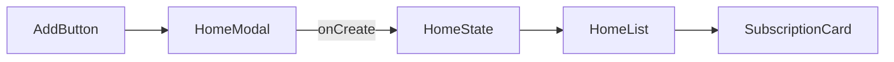

# Requirements

### Overview & Goals
Add a bottom-sheet-style “New Subscription” modal launched from the Home header. A valid submission is added to the beginning of the Home screen’s in-memory subscription list and is immediately rendered with the existing `SubscriptionCard`.

### Functional Requirements
- Open the modal by tapping the `icons.add` header icon; show a transparent overlay, slide-up presentation, title, and close control.
- Provide name and decimal-pad price inputs, Monthly/Yearly toggle buttons, and selectable chips for Entertainment, AI Tools, Developer Tools, Design, Productivity, Cloud, Music, and Other.
- Use the existing auth, picker, and category classes; use `clsx` for conditional classes.
- Prevent submission unless the trimmed name is non-empty and the price is a finite positive number.
- On submit, create a subscription with an ID, selected frequency and category, active status, current start date, frequency-based renewal date, `icons.wallet`, matching `billing`, and category-derived color. Add it at the front of Home state, then reset and close the modal.
- Keep newly created subscriptions in Home route state only; the separate Subscriptions tab remains unchanged. No persistence or dependency additions are in scope.

# Technical Design

### Current Implementation
`src/app/(tabs)/index.tsx` renders `HOME_SUBSCRIPTIONS` directly and displays `icons.add` as a non-interactive `Image`. Its `SubscriptionCard` call overrides each item’s `billing` with an empty string. `src/app/(tabs)/subscriptions.tsx` is a separate route with its own static list and is intentionally out of scope. The global `Subscription` interface in `type.d.ts` has the fields used by the card but no `frequency` field. `src/global.css` already defines `modal-*`, `auth-*`, `picker-*`, and `category-*` classes; `src/constants/icons.ts` exports `icons.add` and `icons.wallet`. `clsx` and `dayjs` are already installed.

### Key Decisions
- Keep state local to the Home route and pass the new item through a modal `onCreate` callback; do not introduce app-wide state or persistence.
- Keep the existing `Subscription` interface compatible with static records by adding optional `frequency?: "Monthly" | "Yearly"`; new modal-created records always populate it and set `billing` to the same value.
- Define the category choices and deterministic category-to-color mapping in `src/constants/data.ts`, reusing the existing subscription color palette where practical.
- Use React Native `Modal` with `transparent` and `animationType="slide"`; use `KeyboardAvoidingView` with iOS padding behavior and the existing modal container sizing.

### Proposed Changes
Create `CreateSubscriptionModal` as a controlled-visibility component with `visible`, `onClose`, and `onCreate(subscription)` props. Keep form inputs and selector state inside it; use `dayjs` to create ISO start and renewal dates one month or year from submission, and generate the ID without adding a package. Disable submission and apply `auth-button-disabled` while the name or price is invalid. On a valid submit, call `onCreate`, clear the form, and close. In Home, prepend the received item with a functional state update, use that state as the FlatList data, and remove the empty billing override so the card renders the selected cadence.

### Data Models / Contracts
The modal callback returns a `Subscription` matching the existing card contract: `id`, `name`, numeric `price`, `frequency`, `category`, `status: "active"`, ISO `startDate` and `renewalDate`, `icon: icons.wallet`, `billing` equal to `frequency`, and category-derived `color`. Add `frequency` as an optional `"Monthly" | "Yearly"` member to the shared interface to preserve compatibility with existing static entries.

### File Structure
- Add `src/components/CreateSubscriptionModal.tsx`.
- Update `src/app/(tabs)/index.tsx` for the add-button interaction, local list state, modal connection, and displayed billing.
- Update `src/constants/data.ts` with category choices and category colors.
- Update `type.d.ts` with the optional frequency field.
- Reuse the existing classes in `src/global.css`, icons in `src/constants/icons.ts`, and `SubscriptionCard`; leave `src/app/(tabs)/subscriptions.tsx` unchanged.

### Architecture Diagram
The Home route owns the list and passes creation through a callback; no cross-tab state is introduced.

# Testing

### Validation Approach
There are no app-level test files or test script in the project. Validate the implementation with the configured lint and TypeScript checks, and inspect the created-item flow against the acceptance criteria.

### Key Scenarios
- Open and dismiss the modal from the Home header; verify frequency and category selections reflect active styles.
- Verify blank names, non-numeric prices, zero, and negative prices cannot create a subscription.
- Create valid Monthly and Yearly subscriptions and verify the item appears first in Home, has the expected dates and category color, and displays its billing cadence.
- Confirm cancel/close leaves the Home list unchanged and successful creation resets the form.
- Run `npx expo lint` and `npx tsc --noEmit`; add no dependencies.

# Delivery Steps

### ✓ Step 1: Build the subscription creation modal and data contract
The modal can collect valid subscription details and return a typed subscription object.

- Add `frequency?: "Monthly" | "Yearly"` to the shared `Subscription` interface in `type.d.ts` while keeping existing static records valid.
- Add the supported category list and category-to-color mapping to `src/constants/data.ts`.
- Create `src/components/CreateSubscriptionModal.tsx` using the existing modal, auth, picker, and category classes; include close behavior, iOS keyboard avoidance, `clsx` active/disabled styling, and name/positive-price validation.
- On valid submission, build the subscription with `icons.wallet`, active status, ISO dates calculated with `dayjs`, matching frequency and billing, category color, and a generated ID; reset form state and notify the parent.

### ✓ Step 2: Connect Home state and validate the create flow
The Home add icon opens the modal and successfully created items appear first with their billing cadence visible.

- Update `src/app/(tabs)/index.tsx` to render the add icon inside a `Pressable` and control modal visibility.
- Initialize Home subscriptions from `HOME_SUBSCRIPTIONS`, prepend new subscriptions with a functional state update, and render that state in the main `FlatList`.
- Remove the empty `billing` override when rendering `SubscriptionCard`; keep the separate Subscriptions tab unchanged.
- Verify valid/invalid creation, dismissal/reset behavior, ordering, Monthly/Yearly dates and billing, and run `npx expo lint` plus `npx tsc --noEmit`.